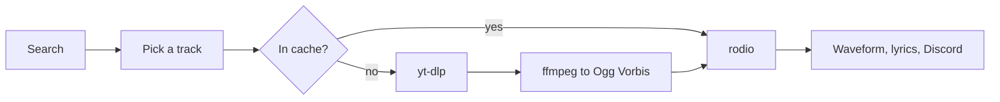

<div align="center">



<br/>

[](https://www.rust-lang.org/)
[](https://github.com/emilk/egui)
[](#install)
[](https://github.com/Opium9Dev/Rustify/actions)
[](https://github.com/Opium9Dev/Rustify/releases)
[](https://github.com/Opium9Dev/Rustify/stargazers)
[](https://github.com/Opium9Dev/Rustify/commits)
[](https://github.com/Opium9Dev/Rustify)

</div>

## What is this

Rustify is a music player for the desktop. You search for a song, it plays, the lyrics scroll in sync. That's the whole idea.

It is a single Rust binary. No Electron, no web view, no account, no API key. The interface is drawn by hand on top of [egui](https://github.com/emilk/egui): the title bar, the widgets, the icons and the animations are all custom.

Search goes through the YouTube Music web endpoint, audio is fetched with `yt-dlp`, converted with `ffmpeg` and played with `rodio`. Everything you listen to is cached on disk, so the second play is instant.

The look is warm black (`#0C0C0E`), cream (`#F2EEE6`) and vermilion (`#FF5C34`). The waveform at the bottom is the signature element of the app: it follows the track, and you can click or drag it to seek.

## What it does

**Playback**
- Search YouTube Music (songs only) without an API key
- Queue, shuffle, repeat, volume
- Clickable waveform for seeking
- Hover a track for a third of a second and it jumps to the front of the download queue, so it is usually ready when you click
- Audio is downloaded once, converted to Ogg Vorbis and kept in a local cache

**Lyrics**
- Synced lyrics from [LRCLIB](https://lrclib.net/), with a plain text fallback
- Titles and artist names are cleaned up before the lookup to get more matches
- Lyrics are saved to disk after the first fetch

**Library**
- Liked tracks and playlists
- A playlist's icon is a collage of the last one to four tracks you added
- Last 20 plays, last 12 searches
- Cover art is downloaded once and cached. The background blur and the accent of the "now playing" card come from the cover's dominant color

**Home**
- A greeting that changes with the time of day (six slots, from early morning to late night), using your first name
- "For you" with a mood selector, one mix per genre you picked, and a top of the week

**Profiles**
- Several profiles, each with its own library, history, playlists, language and theme color
- A default avatar or your own photo, cropped to a circle
- Seven theme colors plus a custom picker with an eyedropper
- Guest mode, which keeps nothing

**Window**
- Windows 11 acrylic background
- Frameless window with a custom title bar
- Mini player: a small always-on-top window, with an animated transition in and out
- Text on top of the accent color switches between black and cream depending on contrast (WCAG ratio)

**Discord**
- Rich Presence showing the track, artist, cover and a progress bar, like Spotify does
- The IPC protocol is written by hand (named pipe on Windows, Unix socket elsewhere), no extra crate
- It reconnects by itself if Discord is opened after Rustify or restarted
- One toggle in the profile menu

**Languages**: English, Français, Italiano, Español, 中文, Русский. The choice is saved per profile.

## Install

### Release build

Download the latest zip from [Releases](https://github.com/Opium9Dev/Rustify/releases), extract it, run `rustify.exe`.

Rustify needs `yt-dlp` and `ffmpeg`. If one is missing on first launch, a small wizard downloads it into `%APPDATA%\Rustify` with a progress bar. No admin rights, no `winget`, no console window. If you already have them, Rustify looks next to the executable and then in your `PATH`.

### From source

You need [Rust](https://rustup.rs/) (stable) and Windows 10 or 11.

```bash
git clone https://github.com/Opium9Dev/Rustify.git
cd Rustify
cargo run --release
```

The binary ends up in `target/release/rustify.exe`. More details are in [docs/BUILDING.md](docs/BUILDING.md).

Linux and macOS: the code has paths for them (Unix socket for Discord, `$HOME/.config` for data), but they are untested and the dependency wizard only works on Windows. Install `yt-dlp` and `ffmpeg` yourself and make sure they are in your `PATH`.

## Using it

1. Create a profile, or go on as a guest.
2. Pick a few genres. They drive the mixes on the home screen.
3. Type something in the search box and hit `Enter`.
4. Click a track. Click or drag the waveform to jump around.
5. Heart it, add it to a playlist, or open the lyrics.
6. Switch to the mini player when you want it out of the way.

`Enter` validates a search or a dialog, `Esc` closes whatever is open, and the arrow keys and `PgUp` / `PgDn` move through dropdown lists.

## How a track gets played



yt-dlp grabs the raw stream, then ffmpeg converts it to Ogg Vorbis. The conversion is there because rodio panicked on the m4a files.

A background thread keeps downloading while you listen: next track first, then recent plays, liked tracks and playlist tracks. It pauses whenever you ask for something yourself.

The cache is capped at about 600 MB and the oldest unused files go first. Liked tracks, playlist tracks, your last 30 plays and the current queue are never removed.

## Project layout

```text
Rustify
├── Cargo.toml, Cargo.lock
├── build.rs
├── rustfmt.toml
├── CONTRIBUTING.md
├── .github/workflows/ci.yml
├── assets/app.ico
├── docs/BUILDING.md
├── scripts/publish.cmd        release helper (Windows)
└── src/
    ├── main.rs
    ├── app.rs                 application state, event loop, installer, cache
    ├── discord.rs             Rich Presence
    ├── i18n.rs                translations
    ├── profile.rs
    ├── audio/                 playback and seeking
    ├── network/               YouTube Music search, LRCLIB
    ├── storage/               profiles, playlists, likes, history
    └── ui/                    home, search, library, player, menus, profiles, style
```

Built with `eframe` / `egui`, `rodio`, `ureq`, `serde_json` and `image`.

## Where your data goes

Everything lives in `%APPDATA%\Rustify` (`~/.config/Rustify` on Unix):

```text
audio/        cached tracks
cache/        cover art
lyrics/       one json file per track
yt-dlp.exe    only if the wizard installed it
ffmpeg.exe    same
```

Profiles, playlists, likes and history sit next to them. Delete the folder and you get a fresh install.

## Contributing

Bug reports and pull requests are welcome. Run `cargo fmt` before you push, and have a look at [CONTRIBUTING.md](CONTRIBUTING.md). If you want to work on something bigger, open an issue first so we can talk about it.

Still missing: proper Linux and macOS support.

## Disclaimer

Rustify is a personal project. It has no link with YouTube, Google or Discord. It relies on third-party tools and public endpoints, and what you play with it is your responsibility, including the terms of the services involved and the copyright rules where you live.

## Thanks

[egui](https://github.com/emilk/egui) for the UI toolkit, [rodio](https://github.com/RustAudio/rodio) for audio, [yt-dlp](https://github.com/yt-dlp/yt-dlp) and [ffmpeg](https://ffmpeg.org/) for the heavy lifting, [LRCLIB](https://lrclib.net/) for the lyrics.

<br/>

<div align="center">



</div>